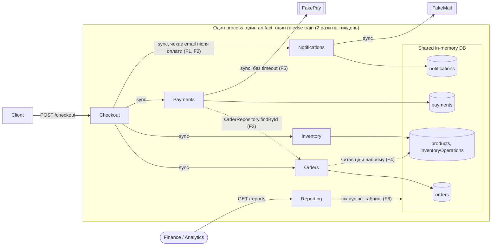
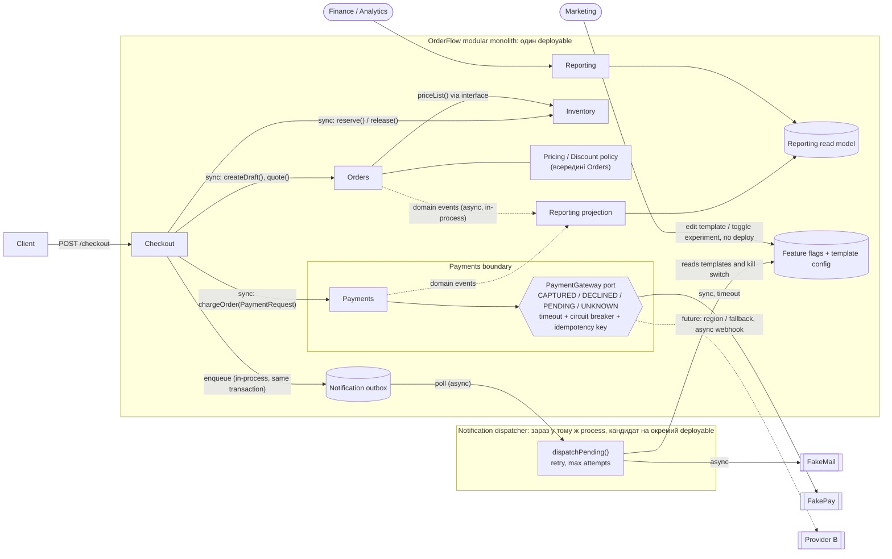
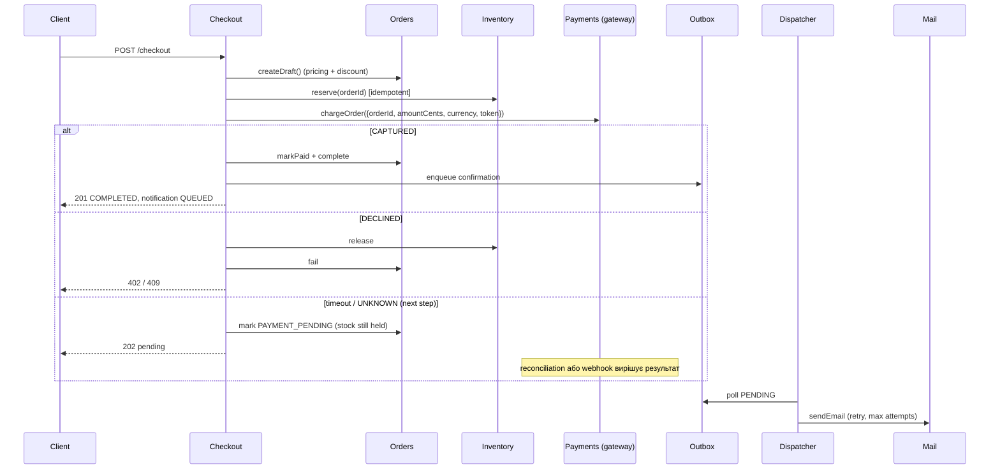

# OrderFlow: Architecture Analysis

Залишаємо modular monolith, але робимо boundaries реальними.
Систему не розбиваємо на окремі сервіси, вона й далі працює як одна програма. Але модулям забороняємо лізти в чужі дані: кожен звертається до іншого лише через його «офіційні двері».

Notifications виходить з critical path.
Раніше checkout чекав, поки відправиться email, і якщо пошта падала, падало все замовлення. Тепер checkout лише ставить лист у чергу й одразу відповідає клієнту, а лист відправляється окремо, трохи згодом.

Payments і Orders отримують explicit contracts.
Payments раніше сам шукав замовлення в чужій таблиці. Тепер йому прямо передають усе потрібне: суму, валюту, номер замовлення. Зміни всередині Orders більше не ламають Payments.

Reporting переходить на read model.
Зараз звіти читають робочі таблиці всіх модулів напряму. План такий: у звітів буде власна копія даних, яка оновлюється з затримкою в кілька хвилин. Тоді звіти не залежать від чужих таблиць і не гальмують checkout.

Правила стають automated fitness functions.
Правила на кшталт «модуль не чіпає чужі таблиці» чи «падіння email не ламає замовлення» тепер записані як тести. Хто їх порушить, у того впаде збірка, і reviewer'у не треба це вишукувати.

Жоден module зараз не стає independently deployable.
Поки що все виходить в одному релізі. Окремі деплої для команди з 8 людей зараз дадуть більше проблем, ніж користі.

Першим кандидатом є Notifications dispatcher, але тільки після trigger conditions.
Якщо колись щось і виносити окремо, то першою буде відправка листів: вона працює у фоні й не потрібна для оплати. Але робимо це лише тоді, коли з'являться конкретні вимірювані причини. Наприклад, зміни коду листів і далі часто чекають спільного релізу навіть після того, як шаблони стануть налаштуваннями.

Розділи 1–7 відповідають пунктам Deliverables з README. Додаток A містить обов'язковий Change cost analysis, Додаток B — optional implementation.


---

## 1. Current architecture



### 1.1 Що видно в коді

| # | Місце | Що відбувається | Наслідок |
| --- | --- | --- | --- |
| F1 | `src/checkout/CheckoutService.js` (до змін) | Статус замовлення ставав `FAILED` після успішної оплати, якщо не вдавалося надіслати сповіщення клієнту (`await sendOrderConfirmation()`) | Падіння email (~2% у FakeMail) дає **списані гроші, order `FAILED`, stock повернуто**. Відтворено: `{ order: 'FAILED', payment: 'CAPTURED', stock: 12 }` |
| F2 | `src/checkout/CheckoutService.js` | Latency email (150-450 ms) входить у checkout latency | у Scenario E бізнес сказав, що лист не впливає на успіх покупки й може прийти згодом. Отже, клієнт чекає на те, що йому в цю мить не потрібне. А в пікові години, коли оплата й так іде 2–3 секунди, ця зайва затримка додається зверху |
| F3 | `src/payments/PaymentService.js` (до змін) | Payments отримує `OrderRepository` і читає чужі дані | Пояснює, чому 48% змін зачіпають і Orders, і Payments одночасно: зміна order shape ламає Payments |
| F4 | `src/orders/OrderService.js` (до змін) | Orders читає `database.products`, тобто таблицю Inventory | Pricing і discount (Scenario F) не мають власника |
| F5 | `src/payments/PaymentService.js` | Немає timeout, немає provider adapter, будь-яка помилка стає `ExternalDependencyError`. Немає станів `DECLINED`, `PENDING`, `UNKNOWN` | Payments чекає на провайдера без обмеження часу (timeout), прив'язаний до одного провайдера і не відрізняє відмову банку від невідомого результату, тому повільний провайдер гальмує checkout, а підключення другого провайдера вимагатиме змін одразу в трьох модулях |
| F6 | `src/reporting/ReportingService.js` | Скан усіх operational collections: O(orders × payments). `productPerformance` бере **поточну** ціну товару | Reporting залежить від internal schema трьох modules і конкурує з checkout за той самий process. Revenue by product некоректний після зміни ціни |

### Responsibilities та dependencies

| Module | Відповідальність | Залежить від | Оцінка |
| --- | --- | --- | --- |
| Checkout | Orchestration flow | Orders, Inventory, Payments, Notifications | Потрібен, але знає забагато про Notifications |
| Orders | Lifecycle order, pricing | Inventory **data** | Pricing лежить у неправильному місці |
| Inventory | Stock, idempotent reserve і release | — | Залишити |
| Payments | Provider call, payment record | Orders **repository**, FakePay | Boundary leak, немає adapter |
| Notifications | Template, delivery | FakeMail | Сидить на critical path |
| Reporting | Звіти | Усі таблиці | Читає чужу schema |

---

## 2. Proposed architecture


Система лишається однією програмою, але модулі спілкуються лише через явні виклики. Checkout синхронно створює замовлення, резервує товар і проводить оплату, а Payments звертається до провайдерів через окремий шлюз (gateway) з timeout і чіткими статусами, тож другий провайдер можна підключити, не змінюючи інші модулі. Email ставиться в чергу й відправляється у фоні, шаблони листів маркетинг змінює без релізу, а звіти читають власну копію даних (read model) і не чіпають робочі таблиці.
У коді вже зроблено чергу листів, явний виклик Payments і отримання цін через Inventory. Шлюз для провайдерів, feature flags і read model поки що лише план, тож за потреби це варто позначити в документі.
### Proposed checkout interaction


Checkout по черзі створює замовлення, резервує товар і проводить оплату, а клієнт отримує відповідь одразу після оплати, не чекаючи на email. Якщо оплату прийнято, замовлення завершується і лист ставиться в чергу; якщо банк відмовив, товар повертається на склад; якщо результат невідомий, товар залишається зарезервованим, доки окрема перевірка не з'ясує, чи пройшли гроші. Лист відправляється окремо у фоні з повторними спробами, тому збій пошти не впливає на покупку.
### Відповіді на 10 питань

| # | Питання | Відповідь |
| --- | --- | --- |
| 1 | Які проблеми справді видно? | F1-F6. Найсерйозніша з них F1: email failure скасовує оплачене замовлення. Це correctness bug, а не лише проблема architecture style |
| 2 | Пріоритетні characteristics? | Розділ 3.1: checkout availability і correctness, потім modifiability hot spots |
| 3 | Dependencies, що найбільше збільшують cost of change? | (1) Checkout → Notifications sync; (2) Payments → OrderRepository; (3) Reporting → чужі таблиці; (4) спільний release train (process, не code) |
| 4 | Що залишити? | Inventory boundary, synchronous core flow Orders/Inventory/Payments, один deployable, один datastore для core modules |
| 5 | Що змінити? | Notifications (async outbox), Payments contract і gateway, pricing через interface, Reporting read model |
| 6 | Чи доречний modular monolith? | **Так.** 8 engineers, немає platform team, навантаження тримає 1 instance. Проблеми спричинені поганими boundaries, а не відсутністю network boundaries |
| 7 | Independently deployable? | **Зараз ні.** Розділ 3.4 описує trigger conditions |
| 8 | Що першим? | Notifications dispatcher, але спершу templates-as-data, що прибирає потребу в deploy для 2-3 експериментів на тиждень узагалі |
| 9 | Trade-offs і нові failure modes | Розділ 3 і розділ 5 |
| 10 | Evidence | Розділ 1.1 (код), Додаток B (зміни в коді), metrics і scenarios у таблицях нижче, fitness tests, які падають на старому коді  |

---

## 3. Decision summary

```text
Problem (у чому проблема)
  Модулі занадто переплетені, тому навіть мала зміна зачіпає кілька
  модулів і довго йде до production. А якщо не відправився email,
  система скасовує замовлення, за яке клієнт уже заплатив.

Evidence (чому я так думаю)
  - Одна зміна зачіпає 4.3 модуля, а пів року тому зачіпала 1.7.
  - Майже половина змін (48%) чіпає і Orders, і Payments, бо Payments
    сам лізе в дані Orders.
  - Checkout чекає на email, тому зміна листа вимагає тестувати весь checkout.
  - Скасування оплаченого замовлення через збій пошти ми відтворили в коді.
  - Checkout чекає на платіжного провайдера скільки завгодно; два останні
    інциденти почалися саме з повільного провайдера.
  - Звіти читають ті самі таблиці, що й checkout, а запитів до звітів стає
    дедалі більше.

Decision (що робимо)
  1. Не розбиваємо систему на окремі сервіси: для 8 розробників це надто
     дорого й складно. Залишаємо одну програму.
  2. Наводимо порядок усередині: кожен модуль працює лише зі своїми даними,
     а з іншими модулями говорить через чіткі виклики.
  3. Email відправляємо у фоні, щоб він не впливав на покупку (зроблено).
  4. Payments отримує готові дані й не лізе в Orders (зроблено).
  5. Додаємо обмеження часу на відповідь платіжного провайдера.
  6. Звіти отримують окрему копію даних і не заважають checkout.
  7. Автоматичні тести перевіряють, що ці правила не порушено (зроблено).

Trade-offs (чим платимо)
  - Email приходить не миттєво, а якщо не дійшов, цього не видно одразу.
    Тому потрібен моніторинг.
  - Звіти відстають від реальних даних на кілька хвилин.
  - Через обмеження часу іноді буде невідомо, чи пройшла оплата.
    Такі випадки треба перевіряти окремо.
  - Реліз лишається спільним для всіх модулів.

How we will measure success (як перевіримо, що допомогло)
  - Одна зміна зачіпає менше 2.5 модуля (зараз 4.3).
  - Зміна доходить до production за 3 дні або швидше (зараз 6).
  - Відкатів менше 4% (зараз 9%).
  - Жодне оплачене замовлення не скасоване через пошту.
  Детальніше в розділі 6.
```

### 3.1 Architectural characteristics: пріоритети

| Пріоритет | Characteristic | Чому | Scenario |
| --- | --- | --- | --- |
| 1 | **Availability і correctness checkout** (reliability, resilience) | Прямий revenue; гроші й stock мають бути узгоджені | E, D |
| 2 | **Modifiability hot spots** (Payments, Notifications, Pricing) | Саме тут найчастіші зміни і найбільше зростання lead time | A, B, F |
| 3 | **Testability / local reasoning** | 2 QA на 8 engineers; full regression є найдорожчим кроком | A |
| 4 | **Deployability** (частота, малий blast radius) | Важлива, але досяжна через flags і process, без independent deploy | A |
| 5 | **Scalability Reporting** | Горизонт 12 місяців, x8-10; read model закриває це поетапно | C |
| 6 | Performance (latency) | Важлива лише для checkout p95, і її покриває пункт 1 | E |
Літери в колонці Scenario відповідають сценаріям з [Change scenarios](change-scenarios.md):
**A** — часті зміни Notifications;
**B** — другий payment provider;
**C** — зростання Reporting;
**D** — Inventory idempotency;
**E** — Checkout availability;
**F** — нове discount rule.

**Чим поступаюся:** миттєвістю email і reports (хвилини прийнятні за business context), незалежним scaling кожного module, незалежним deploy для Payments та Orders. Також приймаю, що частина coupling Orders↔Payments залишиться, бо вона є domain coupling, а не випадковим.

### 3.2 Quality attribute scenarios

| Scenario | Stimulus | Response | Affected | Response measure |
| --- | --- | --- | --- | --- |
| A | Marketing змінює template | Зміна через config/flag, без checkout regression | Notifications | 0 змін в Orders/Checkout; < 1 день до production; вимкнення експерименту < 5 min |
| B | Додаємо provider B | Новий adapter за PaymentGateway | Payments | Зміни лише в `payments/`; Orders і Checkout не змінюються, крім handling `PENDING` один раз |
| C | Reporting x10 | Запити йдуть у read model | Reporting | Checkout p95 не зростає більш ніж на 5% під reporting load; freshness < 5 min |
| D | Повторний reserve/release | Stock змінюється один раз | Inventory | 0 подвійних змін (уже є test) |
| E | FakePay 2-3 s або down | Timeout → PENDING/fallback; email не впливає | Checkout, Payments | Checkout p95 < 3.5 s; 0 checkout failures через email; circuit відкривається < 30 s |
| F | Новий discount | Pricing policy в Orders, сума передається Payments явно | Orders, Reporting projection | ≤ 2 modules; customer бачить фінальну суму до charge |

### 3.3 Що свідомо НЕ змінюється і чому

- **Inventory boundary.** Ідемпотентність через operation key вже працює. Перенесення його за network лише додасть failure modes до операції, яка має бути найбільш consistent.
- **Synchronous Orders - Inventory - Payments.** Customer має отримати відповідь «оплачено чи ні» негайно. Якщо передавати ці кроки через чергу повідомлень, вони виконуватимуться з затримкою, і якийсь час дані не збігатимуться. Тоді товар, який уже закінчився, можна продати ще раз, а цього бізнес допустити не хоче. 
- **Один datastore для core modules.** Data ownership закріплюємо правилами (fitness test), а не окремими базами. Одна транзакція для order, payment record і outbox коштує дешевше за distributed consistency.
- **Один deployment artifact.** Release friction лікуємо частішими windows, flags і меншими PR.

### 3.4 Чому складніша architecture ще не виправдана і коли переглянути

Якщо розбити систему на окремі сервіси, залежності між модулями не зникнуть, а лише підуть через мережу. Майже половина змін (48%) і так чіпає Orders і Payments разом. Після розбиття ці зміни довелося б робити у двох сервісах одночасно, узгоджувати між ними формат даних, випускати двома окремими релізами і зважати на те, що один сервіс працює, а інший упав. Вийшов би «розподілений моноліт»: модулі так само залежать один від одного, тільки працювати з ними складніше. До того ж у команді лише 8 розробників і немає окремих людей для інфраструктури, тож частина розробників займалася б обслуговуванням сервісів замість нових функцій. Proposal чесно називає ці витрати, але не доводить, що окремі релізи чи масштабування зараз є головною проблемою. Метрики показують інше: гальмують переплетені модулі, повільний процес релізу і тестування.

Окремо про Payments: **те, що модуль часто змінюється, ще не причина виносити його в окремий сервіс.** Payments справді змінюється найчастіше. Але дані про оплату мають завжди точно збігатися з даними замовлення і складу, а кожну зміну в ньому обов'язково перевіряє людина. Якщо винести Payments окремо, тримати ці дані узгодженими стане набагато складніше. Тому його варто виносити найпізніше, а не першим.

**Коли варто повернутися до питання про окремі сервіси (trigger conditions):**

| Що виносимо окремо | Коли це має сенс |
| --- | --- |
| Відправку листів (Notification dispatcher) | Шаблони вже стали налаштуваннями, а код листів однаково змінюють частіше ніж 2 рази на тиждень і щоразу чекають спільного релізу. Або відправка листів почала гальмувати checkout |
| Звіти (Reporting) в окрему базу | Запитів до звітів стало більше ніж у 5 разів, ніж зараз. Або через звіти checkout сповільнився більш ніж на 10%. Або finance потрібна історія, якої вже немає в робочій базі |
| Payments | З'явилася окрема команда, яка займається лише платежами. Зміни Orders і Payments разом трапляються рідше ніж у 15% випадків пів року поспіль. Або вимоги безпеки щодо карткових даних (PCI) потребують ізолювати платежі |
| Переглянути всю архітектуру | У команді стало 15-20+ розробників і 3+ команди, кожна зі своїм планом робіт |

### 3.5 Відповіді на Open questions з proposal

| Питання | Відповідь |
| --- | --- |
| **Які modules справді потребують independent deployment зараз?** | Жоден. Найбільше від окремих релізів виграли б листи, але їхню проблему швидше й дешевше вирішити інакше: шаблони стають налаштуваннями, які змінюються без релізу. Відправку листів виносимо окремо лише тоді, коли виконано умови з розділу 3.4 |
| **Чи виправдовує Reporting traffic окреме data store?** | Поки що ні. Спочатку звіти отримують власну копію даних усередині тієї самої програми. Цього достатньо, бо звітам дозволено відставати на кілька хвилин. Окрема база знадобиться, якщо запитів до звітів стане більше ніж у 5 разів або через них checkout сповільниться більш ніж на 10% |
| **Хто відповідає за end-to-end checkout reliability?** | Команда, що відповідає за Orders. Покупка починається і закінчується замовленням, тож саме ця команда стежить, щоб уся покупка працювала, і дивиться на частку успішних покупок і швидкість checkout. Payments відповідає за свою частину: роботу з платіжними провайдерами |
| **Які consistency guarantees потрібні Orders, Payments та Inventory?** | **Узгодженість одразу, а не «з часом».** Поки клієнт не отримав відповідь, має бути точно відомо: товар зарезервовано, оплату прийнято або відхилено, а замовлення має правильний статус. Повторна операція не повинна списати товар чи гроші двічі. Якщо результат оплати невідомий, замовлення чекає на перевірку, а товар лишається зарезервованим. Для листів і звітів затримка в кілька хвилин допустима |
| **Чи достатньо спершу покращити boundaries всередині modular monolith?** | Так. Головна проблема в тому, що модулі переплетені: 48% змін чіпають Orders і Payments разом. Окремі сервіси цього не виправлять, а лише перенесуть ту саму залежність у мережу. Чіткі межі всередині однієї програми потрібні в будь-якому разі, і без них виносити модулі окремо немає сенсу |
---

## 4. Principles

| Principle | Що це означає | Як порушено зараз | Що змінюємо |
| --- | --- | --- | --- |
| **Information Hiding / Ownership** | Кожен модуль сам володіє своїми даними, а інші не лізуть у них напряму | Payments читає замовлення з Orders (F3), Orders читає ціни зі складу (F4), звіти читають усі таблиці (F6) | Модулі отримують чужі дані лише через виклики: `priceList()`, `PaymentRequest`. Звіти поки що виняток, доки в них немає власної копії даних |
| **Explicit Contracts** | Модуль чесно отримує все потрібне через виклик, без прихованих залежностей | З виклику `chargeOrder(orderId, token)` не видно, що Payments сам шукає суму замовлення. Помилки провайдера не розрізняються | Payments отримує суму, валюту і номер замовлення прямо у виклику. Далі додаємо чіткі статуси оплати: прийнято, відмовлено, очікує, невідомо |
| **Design for Change** | Те, що часто змінюється, має змінюватися легко і без ризику | Шаблон листа зашитий у код, і кожна його зміна потребує релізу всієї системи (Scenario A) | Шаблони стають налаштуваннями з можливістю швидко вимкнути експеримент. Новий провайдер оплати підключається як окремий «перехідник» (Scenario B) |
| **Local Reasoning** | Щоб змінити модуль, достатньо розуміти лише його | Щоб змінити лист, треба розуміти, як checkout скасовує замовлення (F1) | Зміна листів більше не впливає на результат покупки, і це перевіряє тест |
| **Fitness Functions** | Правила архітектури перевіряють автоматичні тести, а не лише люди | Межі модулів існували тільки як коментарі в коді | `tests/architecture.test.js` падає, якщо правило порушено. Перевірено: на старому коді тести падають |

---

## 5. Risk analysis

**Assumptions.** У документації немає даних про обсяг продажів, тому числа нижче приблизні. Їхня мета - показати масштаб ризиків, а не точну суму. 
| Припущення | Значення | Звідки і навіщо |
| --- | --- | --- |
| Кількість покупок | ~30 000 на місяць (~1 000 на день) | Припущення для невеликого магазину техніки, якому вистачає одного сервера з резервним (з business context). Потрібне, щоб рахувати, скільки покупок зачепить проблема |
| Середній чек | $250 | Типова ціна товарів у системі: клавіатура $89, монітор $279 |
| Виторг | ≈ $7.5M на місяць, ≈ $250k на день, ≈ $10k на годину в середньому | 30 000 × $250 = $7.5M; ÷ 30 днів; ÷ 24 години. У пікові години виторг вищий, тож оцінка втрат від збою checkout радше занижена |
| Година роботи розробника | $50 | Умовна ставка з прикладу в `docs/analysis-tools.md`. Потрібна, щоб перевести години роботи в гроші |
| Одне звернення в підтримку | $15 | Припущення: ~15-20 хвилин роботи працівника підтримки |
| Період для ймовірності | 1 місяць | Probability означає «наскільки ймовірно, що це станеться хоча б раз за місяць», якщо в рядку не вказано інший період |

```text
Expected Risk Cost = Probability × Business Impact
```

Очікувана вартість ризику = наскільки ймовірно, що він станеться × скільки ми втратимо, якщо станеться.** Наприклад, ризик з імовірністю 50% і збитком $3 000 «коштує» в середньому $1 500.

| # | Risk (що може піти не так) | Probability (ймовірність) | Business Impact (скільки втратимо) | Expected Risk Cost (вартість ризику) | Mitigation (як зменшуємо) |
| --- | --- | ---: | ---: | ---: | --- |
| R1 | **Поточний ризик, уже усунутий.** Лист не відправився, і система скасувала замовлення, за яке клієнт уже заплатив (F1) | ~100%: якщо пошта падає у 2% випадків, це ~600 замовлень на місяць | 600 × ($15 на звернення в підтримку + $15 на повернення грошей) ≈ $18 000, плюс клієнти, які більше не повернуться | **≈ $18 000 на місяць** | Листи відправляються у фоні (зроблено), а тест перевіряє, що збій пошти не скасовує покупку |
| R2 | Платіжний провайдер відповідає дуже повільно, і checkout «зависає». Саме так почалися два останні інциденти | 50% | Година повільного checkout: ~30% клієнтів не завершують покупку ≈ $3 000, плюс 3 години роботи на виправлення ≈ $3 150 | **≈ $1 600 на місяць** | Обмеження часу очікування (~3.5 с), автоматичне «відключення» провайдера, який не відповідає, статус «оплата очікує». Пізніше резервний провайдер |
| R3 | **Новий ризик від нашого рішення.** Ми перестали чекати на провайдера, а він потім усе ж списав гроші. Клієнт може заплатити двічі або заплатити за скасоване замовлення | 40%: при 10% повільних платежів хоча б один такий випадок на місяць майже неминучий | ~10 випадків × ($25 штраф банку за оскарження платежу + $15 підтримка), плюс втрачена довіра ≈ $1 500 | **≈ $600 на місяць** | Провайдер отримує номер замовлення й не спише гроші двічі. Статус «невідомо» не вважаємо відмовою. Товар тримаємо, доки не з'ясуємо результат. Автоматична перевірка кожні 5 хв |
| R4 | **Новий ризик від нашого рішення.** Лист не дійшов, і ніхто цього не помітив. Черга листів зберігається в пам'яті, тож губиться при перезапуску. Через повторні спроби клієнт може отримати лист двічі | 30% | ~200 клієнтів без листа звертаються в підтримку ≈ $3 000 | **≈ $900 на місяць** | Сповіщення, якщо листи чекають у черзі довше 5 хв або не відправилися понад 0.1%. Черга в справжній базі разом із замовленням. Унікальний номер для кожного листа, щоб не надсилати двічі |
| R5 | Запитів до звітів стане у 8-10 разів більше, і вони почнуть гальмувати checkout, бо працюють у тій самій програмі | 50% протягом року | Кілька разів checkout сповільниться в пікову годину ≈ $15 000 | **≈ $7 500 на рік** | Окрема копія даних для звітів, обмеження кількості запитів до звітів, пізніше окрема база |
| R6 | Під час переробки меж модулів щось зламається, бо паралельно команда робить нові функції | 25% за квартал | Один відкат релізу: втрачені продажі + 20 годин роботи ≈ $4 000 | **≈ $1 000 на квартал** | Змінюємо одну межу за реліз, перевіряємо автоматичними тестами, нове вмикаємо через feature flags, без великої переробки за раз |
| R7 | **Якщо прийняти proposal повністю.** Систему розбили на сервіси, але модулі однаково залежать один від одного («розподілений моноліт») | 60% | 2-3 розробники півроку на перехід ≈ 1 500 год × $50 = $75 000, плюс збої стане довше виправляти | **≈ $45 000** (одноразово) | Пропозицію відхилено. Виносимо модулі окремо лише тоді, коли виконано умови з розділу 3.4 |

**Non-obvious trade-off (неочевидна ціна рішення).** Відправка листів у фоні робить checkout надійнішим, але змінює те, як ми дізнаємося про збої пошти. Раніше збій було видно одразу: покупка падала з помилкою. Тепер покупка проходить успішно, а лист просто не приходить, і про це можна дізнатися лише через кілька днів зі скарг у підтримку. Без окремого моніторингу такі проблеми шукатимуть і виправлятимуть довше, ніж раніше. Тому моніторинг черги листів (R4) є обов'язковою частиною рішення, а не побажанням. Ще одна зміна: раніше checkout повертав статус листа `"SENT"` («надіслано»), а тепер `"QUEUED"` («у черзі»). Якщо якась програма чи сайт перевіряли саме `"SENT"`, вони можуть зламатися, тож про цю зміну треба попередити.

**Residual risk (ризик, який ще лишається).** Якщо гроші вже списано, але далі в checkout станеться будь-яка інша помилка (наприклад, під час позначення замовлення оплаченим або завершеним), система так само скасує замовлення і поверне товар на склад, а гроші клієнту не поверне. Після того як лист прибрали з checkout, таке трапляється рідко, але правильно в цьому разі не скасовувати замовлення, а позначати його «потребує перевірки» (`NEEDS_RECONCILIATION`). Це наступний крок, разом із чіткими статусами оплати (R3).

---

## 6. Metrics та Fitness Functions

Метрики показують, чи справді наше рішення допомагає. Остання колонка пояснює, яке значення доведе, що ми помилилися.

| Metric (що міряємо) | Зараз | Ціль | Навіщо | Що покаже, що ми помилилися |
| --- | ---: | ---: | --- | --- |
| Скільки модулів змінюється на одну зміну (Modules Changed per Feature) | 4.3 | < 2.5 за пів року | Прямо показує, наскільки модулі переплетені | Якщо після наших змін лишиться > 3.5, Orders і Payments пов'язані самою суттю бізнесу. Тоді краще віддати їх одній команді, ніж розділяти далі |
| Частка змін, що чіпають і Orders, і Payments | 48% | < 20% | Перевіряє, чи причина була в тому, що Payments лазив у дані Orders (F3) | Якщо не впаде хоча б нижче 30%, явні виклики проблему не вирішили |
| Частка змін шаблонів, що вимагають тестувати весь checkout | 37% | 0% | Сценарій A | — (це гарантує автоматичний тест) |
| Час від початку зміни до production (Change Lead Time) | 6 днів | ≤ 3 дні | Це те, що відчуває бізнес | Міряємо дві частини окремо: від коду до злиття (архітектура і перевірка коду) і від злиття до production (процес релізу). Якщо скоротиться лише перша частина, вкладатися треба в процес релізу |
| Частка невдалих релізів і відкатів (Rollback Rate / Change Failure Rate) | 9% | < 4% | Менші зміни мають рідше ламати систему | Якщо зміни стали меншими, а відкатів не поменшало, проблема в якості тестів |
| Частка успішних покупок (без відмов банку) | — | ≥ 99.5%; 0 зірваних покупок через пошту | Прямо впливає на виторг | — |
| Час відповіді checkout для 95% покупок (p95) | оплата + email | не більше за час оплати + 50 мс; < 3.5 с, навіть коли провайдер гальмує | Сценарій E | — |
| Скільки лист чекає в черзі / частка невідправлених листів | — | < 5 хв / < 0.1% | Ловить «тихі» збої пошти (R4) | Якщо невідправлених > 0.5%, повторні спроби налаштовано погано |
| Скільки часу йде на відновлення після збою (MTTR) | 95 хв | < 45 хв | Інциденти через повільного провайдера | — |

### Fitness Functions (автоматичні перевірки архітектури)

Уже є в `tests/architecture.test.js` і запускаються разом з усіма тестами (`npm test`):

```text
1. Модулі підключають лише спільний код (shared/), а не інші модулі.
2. Кожен модуль працює лише зі своїми таблицями.
   Виняток — звіти: вони поки читають чужі таблиці, і це записано як відомий борг.
3. Платіжного провайдера використовує лише Payments,
   а сховище замовлень (OrderRepository) — лише Orders.
4. Якщо пошта не працює, оплачене замовлення не скасовується.
5. Checkout завершується, навіть якщо пошта взагалі не відповідає
   (тобто покупка не чекає на лист).
```

Ми перевірили, що на старому коді перевірки 2, 3, 4 і 5 **падають**, тобто справді ловлять проблеми:

```text
✖ orders/OrderService.js reads database.products, owned by another module
  (Orders читає таблицю складу)
✖ payments/PaymentService.js uses the Orders repository
  (Payments лізе в дані Orders)
✖ email outage does not fail a paid checkout  (status: 503)
  (збій пошти скасовує покупку)
✖ checkout latency ...
  (checkout завис, чекаючи на пошту; тепер тест обмежено 1 секундою)
```

Що варто додати далі:

```text
- Checkout відповідає швидше ніж за 3.5 с, навіть коли 30% платежів повільні
  (навантажувальний тест щоночі).
- Список винятків для звітів у тесті тільки скорочується; додавати нові заборонено.
- Правило для перевірки коду: зміна, що зачіпає > 3 модулів або > 400 рядків,
  потребує окремого пояснення від автора.
```

---

## 7. AI та Time to Market

Time to Market (TTM) — це скільки часу минає від ідеї великої функції до її появи в production.

### 7.1 Чи правда, що «AI у 4 рази швидше» означає «4 місяці стануть 1»?

Ні. Тут змішано дві різні речі: **як швидко пишеться код** і **як швидко функція доходить до клієнтів**. Написання коду займає лише 40 зі 120 днів, тобто третину. Навіть якби AI писав код миттєво, лишилося б 80 днів, тобто ≈ 2.7 місяця. Тож 1 місяць неможливий, якщо не прискорити інші етапи, хоч яким добрим буде AI.

Крім того, число «у 4 рази» нічим не підтверджене: немає даних, скільки помилок у коді від AI. Код, що стосується безпеки й грошей, однаково перевіряє людина, а перевірку коду вже зараз чекають у черзі до двох senior-розробників.

### 7.2 Оцінка кожного етапу (у днях)

| Етап | Зараз | **Лише AI** (більше нічого не змінюємо) | **AI + наші зміни**: обережно / реально / оптимістично | Чому так |
| --- | ---: | ---: | ---: | --- |
| Аналіз (Analysis) | 20 | 18 | 18 / 16 / 15 | AI допомагає швидше зібрати інформацію й зробити прототип, але все впирається в те, коли знайдуть час stakeholders |
| Написання коду (Implementation) | 40 | 15 | 20 / 18 / 12 | AI пише заготовки й тести. Гальмують перевірка коду (лише 2 senior), обов'язкова перевірка людиною коду платежів і безпеки |
| Інтеграція (Integration) | 25 | **28** ↑ | 19 / 17 / 13 | Лише AI: зміни більші (вже 520 рядків), їх довше зводити разом. З нашими змінами: чіткі виклики між модулями, тести на них, менше модулів на зміну |
| Тестування (Validation) | 25 | **27** ↑ | 20 / 17 / 13 | Лише AI: більше коду стоїть у тій самій черзі (1 тестове середовище, 2 QA). З нашими змінами: друге тестове середовище прибирає чергу в 3-5 днів, більше автотестів, менше треба перевіряти вручну |
| Реліз (Release) | 10 | 10 | 8 / 6 / 4 | Релізи щодня замість двох разів на тиждень, feature flags, менше ручних погоджень |
| Етапи частково йдуть паралельно | — | — | 0 / −3 / −5 | Feature flags дозволяють частину тестування робити одночасно з інтеграцією. Але покращення **не можна просто скласти**, бо вони частково перекривають одне одного |
| **Разом** | **120** | **98 (≈ 3.3 міс)** | **85 / 71 / 52** (≈ 2.8 / 2.4 / 1.7 міс) | |

### 7.3 Наша ціль

**≈ 2.5 місяця (70-75 днів) на велику функцію, яку почнуть приблизно через пів року, коли будуть готові підготовчі зміни. Реалістичний діапазон: 2-3 місяці. Ціль на рік: ~2 місяці.**

- У перші місяці TTM може навіть **зрости**, бо частина команди займатиметься переробкою: черга листів, шлюз платежів, копія даних для звітів, тестове середовище, тести. Це одноразові витрати, і користь з'явиться з другої-третьої великої функції.
- Оптимістичні 1.7 місяця вийдуть, лише якщо всі покращення спрацюють одночасно й ідеально. Планувати на це не можна.

### 7.4 Які етапи AI справді прискорює

- **Написання коду:** так, помітно (заготовки, тести, переробка коду). Але лише доти, доки встигають перевіряти код.
- **Аналіз:** трохи (пошук інформації, швидкий прототип).
- **Тестування:** частково (AI пише тестові сценарії), але не прибирає черги до єдиного тестового середовища й не замінює двох QA.
- **Інтеграція й реліз:** майже ні. Тут гальмують архітектура й процеси, а не швидкість написання коду.

### 7.5 Де робота застрягатиме далі

```text
Написання коду ──(AI)──► Перевірка коду (2 senior) ──► QA (2 людини) ──► Тестове середовище (1, черга 3-5 днів) ──► Реліз (2 рази на тиждень)
```

Якщо прискорити лише написання коду, готовий код просто накопичуватиметься в черзі на перевірку й тестування. Швидкість усього процесу визначає найповільніший етап, а не найшвидший.

### 7.6 Що гальмує: архітектура чи процеси

| Через архітектуру | Через процеси |
| --- | --- |
| 48% змін чіпають і Orders, і Payments, тож довше зводити все разом | Лише одне тестове середовище, черга 3-5 днів |
| Листи були частиною checkout, тож доводилося тестувати все (виправлено) | Релізи лише 2 рази на тиждень |
| Звіти читають чужі таблиці й ламаються від змін в Orders чи Payments | Ручні погодження (частина з 27 хвилин deploy) |
| Одна програма: якщо відкотити, відкочується весь реліз | Перевірку коду чекають до двох senior: знання про архітектуру є лише в них |
| Немає «перехідника» для платіжних провайдерів, тож будь-яка зміна провайдера чіпає checkout | Обов'язкова перевірка людиною коду безпеки й платежів (**залишаємо**, це правильний контроль) |
| | 2 QA на 8 розробників: з AI розробники пишуть більше, і QA не встигатимуть ще більше |
| | Stakeholders не завжди мають час на етапі аналізу |
| | Немає даних, скільки помилок дає код від AI |

### 7.7 Чи реально встигати за 1 місяць?

**За теперішніх умов ні.** Навіть з ідеальним AI виходить щонайменше 80 днів. Щоб випускати функції щомісяця, мало б змінитися таке:

1. **Ділити великі функції на маленькі частини**, які щотижня йдуть у production за feature flags. Тоді «велика функція» стає серією невеликих релізів. Це найсильніший важіль, і він не технічний.
2. **Випускати часто:** щодня або будь-коли за потреби, з автоматичними погодженнями. Тоді реліз займає ≈ 1-2 дні.
3. **Інтеграцію перевіряти автоматично** при кожній зміні (тести на виклики між модулями), а одна зміна зачіпає не більше 2 модулів. Тоді інтеграція займає ≈ 3-5 днів.
4. **Окреме тимчасове тестове середовище для кожної зміни** і автоматичні регресійні тести. Тоді тестування займає ≈ 5-7 днів, а QA зосереджуються на ручному пошуку проблем.
5. **Аналізувати наступну частину**, поки пишеться код попередньої.
6. **Більше людей, які можуть перевіряти код:** записані архітектурні рішення, зрозуміло, хто за що відповідає, щонайменше 4-5 рецензентів, правило «одна зміна не більше 400 рядків».

Приблизно виходить 7 + 10 + 4 + 6 + 2 ≈ **29 днів**. Це реально протягом 12-18 місяців, але як **інший спосіб роботи команди**, а не завдяки самому AI.

### 7.8 Що потрібно для нашої цілі, скільки це коштує і чим ризикуємо

| Що потрібно | Скільки це коштує | Чим ризикуємо |
| --- | --- | --- |
| Друге тестове середовище | Гроші на інфраструктуру (бюджет дозволяють, якщо результат можна виміряти: черга має зникнути) | Середовища почнуть відрізнятися, і тест пройде там, а не в production |
| Тести на виклики між модулями й перевірки архітектури | ~2-3 тижні роботи 1-2 розробників, далі підтримка | Тести перетворяться на формальність, якщо їх не оновлювати |
| Черга листів, шлюз платежів, копія даних для звітів | ~3 місяці поступово, паралельно з новими функціями | Під час переробки щось зламається (R6) |
| Щоденні релізи й feature flags | Система флагів і дисципліна прибирати старі | Старі флаги накопичуються, і стає важко зрозуміти, яка комбінація ввімкнена |
| Більше людей, які вміють перевіряти код | Час senior на навчання колег і запис рішень | Спочатку робота трохи сповільниться |

### 7.9 Нові ризики, коли коду пишеться більше

- **Зміни стають більшими, і рецензенти втомлюються.** Уже зараз зміна в середньому 520 рядків. Код від AI перевіряють поверхнево, і частіше трапляються невдалі релізи.
- **AI ігнорує межі модулів.** Згенерований код охоче звертається до чужої таблиці з будь-якого модуля. Тому автоматичні перевірки архітектури тут стають справжнім захистом, а не формальністю.
- **Помилки в коді платежів і безпеки.** Людина перевіряє такий код обов'язково, але вона вже перевантажена.
- **Черги на перевірку й тестування ростуть**, тож функції можуть доходити до клієнтів **повільніше**, хоча коду пишеться більше.
- **Команда гірше розуміє код, який сама не писала**, тож збої виправляють довше (зараз уже 95 хв).
- **Тестів стає забагато.** AI генерує багато тестів, і deploy триває довше (27 хв уже частково через це).

### 7.10 Як виміряти реальну користь від AI (а не кількість рядків чи змін)

- **Скільки часу робота проводить на кожному етапі**, щоб бачити, де саме вона чекає.
- **Скільки зміна чекає на перевірку** і скільки триває весь шлях від коду до злиття, окремо від часу на написання.
- **Скільки помилок і невдалих релізів** дають зміни з AI порівняно з іншими (такі зміни позначаємо окремою міткою).
- **Скільки коду переписують** протягом 2-3 тижнів після злиття.
- **Скільки загалом займає велика функція від ідеї до клієнтів.** Саме це обіцяли stakeholders.

### 7.11 Що змусить переглянути прогноз після першої великої функції

| Що побачимо | Що це означає |
| --- | --- |
| Код написали за ≤ 12 днів, а вся функція зайняла > 90 днів | Гальмує не код. Вкладаємося в тестове середовище й релізи |
| Зміни з AI ламають систему в 1.5 раза частіше за інші | Сповільнюємося, посилюємо перевірку й тести, збільшуємо оцінку часу на код |
| Очікування перевірки коду займає > 30% усього часу | Спершу вчимо більше людей перевіряти код, а не купуємо нові AI-інструменти |
| Інтеграція не скоротилась, хоча виклики між модулями стали чіткими | Межі модулів обрано неправильно, треба їх переглянути (див. метрику спільних змін Orders і Payments) |
| Після другого тестового середовища черги немає, а функція зайняла ≤ 65 днів | Ціль можна знизити до 2 місяців |

---

## Додаток A. Change cost analysis

Тут ми рахуємо, скільки коштує типова зміна зараз і скільки коштуватиме після наших змін. Числа приблизні, а година роботи коштує $50.

### Change A: новий експеримент із шаблоном листа (2-3 на тиждень, ≈ 125 на рік)

| | Зараз | Крок 1: листи у фоні + межі модулів (зроблено) | Крок 2: шаблони як налаштування + feature flags |
| --- | --- | --- | --- |
| Які модулі змінюємо | Notifications, а в 37% випадків ще й повністю тестуємо checkout | Тільки Notifications | Жодного: маркетинг змінює налаштування |
| Скільки годин роботи | 4 год розробка + 1 год перевірка коду (чекаємо на senior) + 3 год тестування checkout (8 год × 37%) + 2 год узгодження ≈ **10 год** | 4 год розробка + 1 год перевірка коду + 1 год тести листів + 1 год реліз ≈ **7 год** | 1 год маркетинг редагує шаблон + 0.5 год перевіряє, як він виглядає ≈ **1.5 год** |
| Кого треба узгоджувати | Календар релізів, вільний час QA, усі модулі в одному релізі | Календар релізів | Нікого |
| Що тестуємо | У 37% випадків увесь checkout | Лише листи; тест гарантує, що checkout не зачеплено | Лише вигляд шаблону |
| Що випускаємо | Усю систему, а при відкаті відкочується весь реліз | Поки що всю систему | Нічого не випускаємо; експеримент вимикається за < 5 хв |
| Скільки чекати до production | 3-4 дні (до найближчого релізу) | 1-3 дні | Того самого дня |
| Вартість однієї зміни | **$500** | **$350** | **$75** |

```text
Architecture Tax (зайві витрати через архітектуру)
  = вартість зараз - вартість у кращому варіанті
  = $500 − $75 = $425 на одну зміну
  ≈ $425 × 125 змін = ~$53 000 на рік
  (і це без урахування того, що експерименти чекають днями)
```

### Change F: нова знижка для певного способу оплати й набору товарів

| | Зараз | Після змін |
| --- | --- | --- |
| Які модулі змінюємо | **5-6**: Orders (рахує суму), `shared/money` (формула), Checkout, Payments (сам бере суму із замовлення), Reporting (читає таблиці замовлень напряму), Notifications (сума в листі) | **2-3**: Orders (правило знижки), Checkout (передає спосіб оплати), звіти (нове поле «знижка») |
| Скільки годин роботи | 24 год розробка + 8 год узгодження (2 команди + finance) + 16 год повне тестування + 4 год реліз ≈ **52 год ≈ $2 600** | 16 год розробка + 3 год узгодження + 8 год тестування Orders + 2 год реліз ≈ **29 год ≈ $1 450** |
| Чому така різниця | Ніхто не «володіє» розрахунком ціни, а Payments і звіти залежать від того, як усередині влаштоване замовлення | Payments отримує готову суму, а звіти отримують повідомлення «замовлення оформлено зі знижкою X» і не читають чужих таблиць |

Оцінки отримано, коли ми розбили задачу на кроки й порівняли з метрикою «4.3 модуля на зміну». Перевірити їх просто: після першої реальної знижки порівняти з фактично витраченими годинами.

---

## Додаток B. Optional implementation (зроблено)

Щоб підкріпити аналіз, ми внесли кілька невеликих змін у код:

| Що зроблено | Де |
| --- | --- |
| Листи тепер ставляться в чергу й відправляються у фоні з повторними спробами; checkout на них не чекає | `src/notifications/NotificationService.js`, `src/checkout/CheckoutService.js`, `src/database.js`, `src/server.js` (фонова відправка раз на секунду), `src/config.js` (налаштування `NOTIFICATION_DISPATCH_INTERVAL_MS`, `NOTIFICATION_MAX_ATTEMPTS`) |
| Payments більше не лізе в дані Orders, а отримує суму, валюту й номер замовлення прямо у виклику | `src/payments/PaymentService.js`, `src/app.js` |
| Orders бере ціни через Inventory (`priceList()`), а не з таблиці складу напряму | `src/orders/OrderService.js`, `src/inventory/InventoryService.js` |
| Автоматичні перевірки архітектури | `tests/architecture.test.js` |
| Старі тести й демо оновлено: статус листа тепер `QUEUED` («у черзі») замість `SENT` | `tests/checkout.test.js`, `src/demo.js` |

Перевірка на запущеному сервері: пошта падала в половині випадків (`NOTIFICATION_FAILURE_RATE=0.5`), ми зробили 6 покупок. Усі 6 завершились успішно, а листи дійшли з повторних спроб. До змін приблизно половина цих покупок упала б з помилкою вже після списання грошей.
