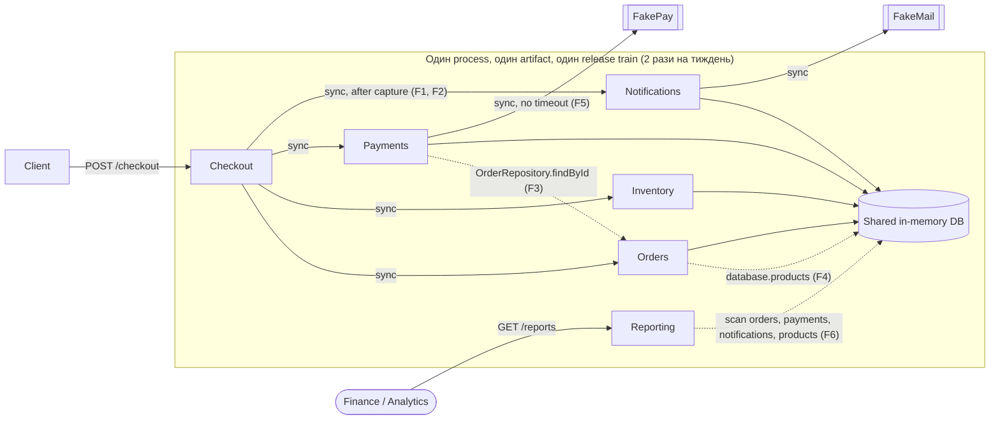
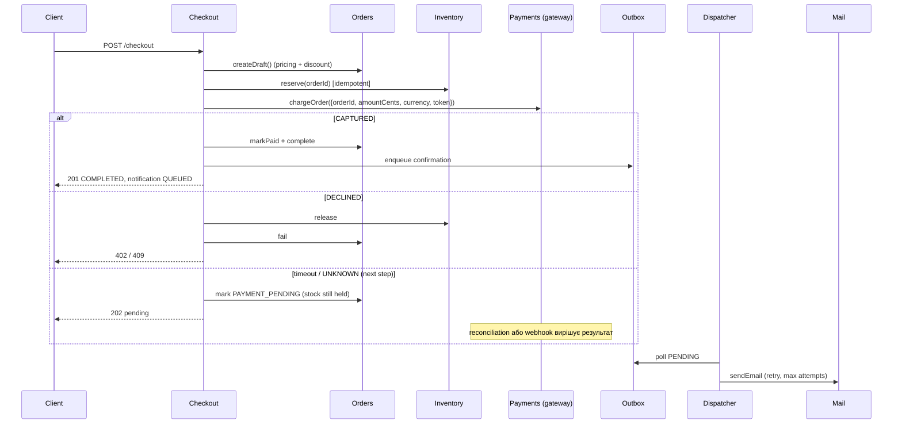

# OrderFlow: Architecture Analysis

Коротко: **залишаємо modular monolith, але робимо boundaries реальними.** Notifications виходить з critical path, Payments і Orders отримують explicit contracts, Reporting переходить на read model, а правила стають automated fitness functions. Жоден module зараз не стає independently deployable. Першим кандидатом на це є Notifications dispatcher, але тільки після виконання явних trigger conditions (розділ 3.4).

Частину рішення вже реалізовано в коді як evidence. Деталі в розділі 8.

---

## 0. Що видно в коді (факти, а не припущення)

| # | Місце | Що відбувається | Наслідок |
| --- | --- | --- | --- |
| F1 | `src/checkout/CheckoutService.js` (до змін) | `await sendOrderConfirmation()` **після** capture платежу; у `catch` stock звільняється, order отримує `FAILED` | Падіння email (~2% у FakeMail) дає **списані гроші, order `FAILED`, stock повернуто**. Відтворено: `{ order: 'FAILED', payment: 'CAPTURED', stock: 12 }` |
| F2 | там само | Latency email (150-450 ms) входить у checkout latency | Checkout p95 = payment p95 + email p95. Scenario E порушено |
| F3 | `src/payments/PaymentService.js` (до змін) | Payments отримує `OrderRepository` і читає чужі дані | Пояснює, чому 48% PR торкаються Orders і Payments одночасно: зміна order shape ламає Payments |
| F4 | `src/orders/OrderService.js` (до змін) | Orders читає `database.products`, тобто таблицю Inventory | Pricing і discount (Scenario F) не мають власника |
| F5 | `src/payments/PaymentService.js` | Немає timeout, немає provider adapter, будь-яка помилка стає `ExternalDependencyError`. Немає станів `DECLINED`, `PENDING`, `UNKNOWN` | Scenario B (async confirmation, інший error model) зачепить Payments, Checkout і Orders. Slow provider (10% викликів по 1.5-3 s) блокує checkout |
| F6 | `src/reporting/ReportingService.js` | Скан усіх operational collections: O(orders × payments). `productPerformance` бере **поточну** ціну товару | Reporting залежить від internal schema трьох modules і конкурує з checkout за той самий process. Revenue by product некоректний після зміни ціни |
| F7 | `src/inventory/InventoryService.js` | Reserve і release ідемпотентні через operation key | **Добрий boundary**, Scenario D уже задоволено |

Import-level boundaries були чисті (кожен module імпортує лише `shared/`). Реальний coupling проходив через **спільний `database` object і constructor injection чужих repositories**. Саме тому звичайний linter його не бачив.

---

## 1. Current architecture



Пунктир позначає dependencies, що збільшують cost of change. Суцільні лінії між Checkout і core modules є виправданим coupling, бо checkout потребує негайної узгодженої відповіді.

### Responsibilities та dependencies

| Module | Відповідальність | Залежить від | Оцінка |
| --- | --- | --- | --- |
| Checkout | Orchestration flow | Orders, Inventory, Payments, Notifications | Потрібен, але знає забагато про Notifications |
| Orders | Lifecycle order, pricing | Inventory **data** | Pricing лежить у неправильному місці |
| Inventory | Stock, idempotent reserve і release | — | Залишити |
| Payments | Provider call, payment record | Orders **repository**, FakePay | Boundary leak, немає adapter |
| Notifications | Template, delivery | FakeMail | Сидить на critical path |
| Reporting | Звіти | Усі таблиці | Читає чужу schema |

---

## 2. Proposed architecture


### Proposed checkout interaction



### Відповіді на 10 питань

| # | Питання | Відповідь |
| --- | --- | --- |
| 1 | Які проблеми справді видно? | F1-F6. Найсерйозніша з них F1: email failure скасовує оплачене замовлення. Це correctness bug, а не лише проблема architecture style |
| 2 | Пріоритетні characteristics? | Розділ 3.1: checkout availability і correctness, потім modifiability hot spots |
| 3 | Dependencies, що найбільше збільшують cost of change? | (1) Checkout → Notifications sync; (2) Payments → OrderRepository; (3) Reporting → чужі таблиці; (4) спільний release train (process, не code) |
| 4 | Що залишити? | Inventory boundary, synchronous core flow Orders/Inventory/Payments, один deployable, один datastore для core modules |
| 5 | Що змінити? | Notifications (async outbox), Payments contract і gateway, pricing через interface, Reporting read model |
| 6 | Чи доречний modular monolith? | **Так.** 8 engineers, немає platform team, навантаження тримає 1 instance. Проблеми спричинені поганими boundaries, а не відсутністю network boundaries |
| 7 | Independently deployable? | **Зараз ні.** Розділ 3.4 описує trigger conditions |
| 8 | Що першим? | Notifications dispatcher, але спершу templates-as-data, що прибирає потребу в deploy для 2-3 експериментів на тиждень узагалі |
| 9 | Trade-offs і нові failure modes | Розділ 3 і розділ 5 |
| 10 | Evidence | Розділ 0 (код), metrics і scenarios у таблицях нижче, fitness tests, які падають на старому коді (розділ 8) |

---

## 3. Decision summary

```text
Problem
  Проста зміна зачіпає 4.3 modules замість 1.7, lead time виріс з 2 до 6 днів,
  rollback rate з 2% до 9%. Checkout (revenue) залежить від email provider, а
  оплачене замовлення може стати FAILED.

Evidence
  - Code: F1-F6 (розділ 0); помилку F1 відтворено.
  - 48% feature PR торкаються Orders + Payments; у коді Payments читає OrderRepository (F3).
  - 37% змін notification templates вимагають checkout regression; у коді email
    викликається всередині checkout transaction (F1/F2).
  - 2 останні incidents почалися з payment latency; у коді немає timeout (F5).
  - Reporting traffic x3 за рік, прогноз x8-10; Reporting сканує operational data в process checkout (F6).
  - Deployment duration 8 → 27 min частково через test suite і manual approvals,
    тобто це process, не architecture.

Decision
  1. Залишити modular monolith і один deployable.
  2. Notifications → transactional outbox + dispatcher; templates і experiments як data з kill switch.
  3. Payments → explicit PaymentRequest contract (зроблено) + PaymentGateway port з
     нормалізованим result model, timeout, idempotency key, circuit breaker.
  4. Pricing і Discount policy належать Orders; Inventory надає priceList() (зроблено).
     Order зберігає unit price і discount lines.
  5. Reporting → in-process projection з domain events у read model (freshness у хвилинах).
  6. Boundaries закріплюються fitness tests у CI (зроблено).
  7. Proposal "5 independently deployable services" відхилено; кроки 1-2 proposal прийнято,
     крок 3 (async messaging) прийнято тільки для Notifications і Reporting.

Trade-offs
  - Email стає eventual: швидший і надійніший checkout в обмін на "тихі" failures.
  - Reporting стає stale на хвилини в обмін на ізоляцію schema та load.
  - Payment timeout створює новий стан UNKNOWN, а з ним reconciliation.
  - Більше коду (outbox, projection, gateway) без нової infrastructure.
  - Залишаємо спільний release train; його лікуємо process changes і feature flags.

How we will measure success
  Modules Changed per Feature 4.3 → < 2.5; Change Lead Time 6 → ≤ 3 days;
  Rollback Rate 9% → < 4%; checkout failures через notifications 0;
  template changes з checkout regression 37% → 0%. Деталі в розділі 6.
```

### 3.1 Architectural characteristics: пріоритети

| Пріоритет | Characteristic | Чому | Scenario |
| --- | --- | --- | --- |
| 1 | **Availability і correctness checkout** (reliability, resilience) | Прямий revenue; гроші й stock мають бути узгоджені | E, D |
| 2 | **Modifiability hot spots** (Payments, Notifications, Pricing) | Саме тут найчастіші зміни і найбільше зростання lead time | A, B, F |
| 3 | **Testability / local reasoning** | 2 QA на 8 engineers; full regression є найдорожчим кроком | A |
| 4 | **Deployability** (частота, малий blast radius) | Важлива, але досяжна через flags і process, без independent deploy | A |
| 5 | **Scalability Reporting** | Горизонт 12 місяців, x8-10; read model закриває це поетапно | C |
| 6 | Performance (latency) | Важлива лише для checkout p95, і її покриває пункт 1 | E |

**Чим свідомо поступаємося:** миттєвістю email і reports (хвилини прийнятні за business context), незалежним scaling кожного module, незалежним deploy для Payments та Orders. Також приймаємо, що частина coupling Orders↔Payments залишиться, бо вона є domain coupling, а не випадковим.

### 3.2 Quality attribute scenarios

| Scenario | Stimulus | Response | Affected | Response measure |
| --- | --- | --- | --- | --- |
| A | Marketing змінює template | Зміна через config/flag, без checkout regression | Notifications | 0 змін в Orders/Checkout; < 1 день до production; вимкнення експерименту < 5 min |
| B | Додаємо provider B | Новий adapter за PaymentGateway | Payments | Зміни лише в `payments/`; Orders і Checkout не змінюються, крім handling `PENDING` один раз |
| C | Reporting x10 | Запити йдуть у read model | Reporting | Checkout p95 не зростає більш ніж на 5% під reporting load; freshness < 5 min |
| D | Повторний reserve/release | Stock змінюється один раз | Inventory | 0 подвійних змін (уже є test) |
| E | FakePay 2-3 s або down | Timeout → PENDING/fallback; email не впливає | Checkout, Payments | Checkout p95 < 3.5 s; 0 checkout failures через email; circuit відкривається < 30 s |
| F | Новий discount | Pricing policy в Orders, сума передається Payments явно | Orders, Reporting projection | ≤ 2 modules; customer бачить фінальну суму до charge |

### 3.3 Що свідомо НЕ змінюється і чому

- **Inventory boundary.** Ідемпотентність через operation key вже працює (F7, test). Перенесення його за network лише додасть failure modes до операції, яка має бути найбільш consistent.
- **Synchronous Orders → Inventory → Payments.** Customer має отримати відповідь «оплачено чи ні» негайно. Saga через queue тут дала б eventual consistency там, де бізнес її не хоче (overselling, Scenario D).
- **Один datastore для core modules.** Data ownership закріплюємо правилами (fitness test), а не окремими базами. Одна транзакція для order, payment record і outbox коштує дешевше за distributed consistency.
- **Один deployment artifact.** Release friction лікуємо частішими windows, flags і меншими PR (розділ 7).

### 3.4 Чому складніша architecture ще не виправдана і коли переглянути

Повний перехід на services перетворив би **in-process coupling на network coupling**. Оскільки 48% PR уже змінюють Orders і Payments разом, ми отримали б distributed monolith: ті самі co-changes, але з versioned API, двома pipelines і partial failures. Без platform team ці 8 engineers витрачали б помітну частину capacity на operations. Proposal правильно описує costs, але не показує, що benefit (independent deploy, scaling) зараз є bottleneck. Metrics кажуть інше: bottleneck у co-change, release process і тестуванні.

Окремо про Payments: **висока частота змін не означає, що module треба робити independently deployable.** Payments змінюється найчастіше, але має найсуворіші вимоги до consistency з Orders та Inventory і потребує human review. Тому це найгірший кандидат на перше виділення.

**Trigger conditions для майбутньої еволюції:**

| Крок | Умова |
| --- | --- |
| Notification dispatcher як окремий worker | Templates-as-data впроваджено, а зміни notification **code** все ще > 2 на тиждень і чекають release window; або dispatch впливає на checkout resources |
| Reporting окремий read store / replica | Reporting traffic > 5x поточного, або checkout p95 під reporting load зростає > 10%, або finance потребує history за межами operational retention |
| Payments як service | Окрема постійна team з ownership Payments; boundary стабільний (co-change Orders+Payments < 15% два квартали поспіль); є вимога звузити PCI scope |
| Загальний перегляд | Команда > 15-20 engineers і 3+ teams із незалежними roadmaps |

---

## 4. Principles

| Principle | Де порушено зараз | Що змінює рішення |
| --- | --- | --- |
| **Information Hiding / Ownership** | Payments читає `OrderRepository` (F3), Orders читає `products` (F4), Reporting читає всі таблиці (F6) | Кожна collection має власника; доступ іде через interface (`priceList()`, `PaymentRequest`). Reporting лишається задокументованим виключенням, доки немає read model |
| **Explicit Contracts** | `chargeOrder(orderId, token)` приховує, що Payments сам шукає суму; provider errors не мають model | `chargeOrder({ orderId, amountCents, currency, paymentToken })`; наступний крок: result model `CAPTURED/DECLINED/PENDING/UNKNOWN` |
| **Design for Change** | Template у коді, deploy разом з усім (Scenario A) | Template як data, flag/kill switch; новий provider як новий adapter (Scenario B) |
| **Local Reasoning** | Щоб змінити email, треба розуміти checkout rollback (F1) | Зміна Notifications не може змінити результат checkout: це перевіряє fitness test |
| **Fitness Functions** | Boundaries існували лише як коментарі «Deliberate boundary leak» | `tests/architecture.test.js` падає на порушенні; перевірено на старому коді |

---

## 5. Risk analysis

**Assumptions** (явні, приблизні): ~30 000 checkout на місяць, середній чек $250 (≈ $250k revenue на день, ≈ $10k на годину пікової години), engineering cost $50/h, support case $15. Probability рахується на місяць, якщо не сказано інше.

```text
Expected Risk Cost = Probability × Business Impact
```

| # | Risk | Probability | Business Impact | Expected Risk Cost | Mitigation |
| --- | --- | ---: | ---: | ---: | --- |
| R1 | **(Поточний, усунутий)** Email failure після capture скасовує оплачене замовлення (F1) | ~100% (при 2% failure rate ≈ 600 випадків/міс) | 600 × ($15 support + $15 refund handling) ≈ $18 000 + churn | **≈ $18 000/міс** | Outbox (зроблено) + fitness test «email outage does not fail a paid checkout» |
| R2 | Payment provider latency spike блокує checkout (2 з останніх incidents) | 50% | 1 год degraded checkout × 30% втрачених конверсій ≈ $3 000 + 3 h recovery ≈ $3 150 | **≈ $1 600/міс** | Timeout ~3.5 s, circuit breaker, стан `PENDING`, пізніше fallback provider через gateway |
| R3 | **(Створює власне рішення)** Payment timeout дає `UNKNOWN`: provider списав гроші після нашого timeout → подвійне списання або paid-but-failed | 40% (хоча б один випадок/міс при 10% slow calls) | ~10 випадків × ($25 chargeback fee + $15 support) + reputation ≈ $1 500 | **≈ $600/міс** | Idempotency key = orderId до provider; `UNKNOWN` ≠ `FAILED`; stock тримається до reconciliation; reconciliation job кожні 5 min |
| R4 | **(Створює власне рішення)** Тихі notification failures: email не доставлено, ніхто не помітив; in-memory outbox втрачається при restart; at-least-once delivery дає дублікати | 30% | ~200 customers без email → support $3 000 | **≈ $900/міс** | Alert на outbox age p95 > 5 min і `FAILED` > 0.1%; persistent outbox в одній транзакції з order (коли буде real DB); idempotency key на message |
| R5 | Reporting load (x8-10) деградує checkout у спільному process | 50% за 12 міс | Деградація в пікову годину кілька разів ≈ $15 000 | **≈ $7 500/рік** | Read model, rate limit на `/reports`, далі replica за trigger condition |
| R6 | Regression під час refactoring boundaries паралельно з feature delivery | 25% за квартал | 1 rollback incident ≈ $4 000 (revenue + 20 h) | **≈ $1 000/квартал** | Один boundary за release, fitness tests, flags, strangler-кроки без big bang |
| R7 | **(Якщо прийняти proposal повністю)** Distributed monolith: services, але co-change лишається | 60% | 2-3 engineers × 6 міс ≈ 1 500 h × $50 = $75 000 + зростання MTTR | **≈ $45 000** | Відхилено. Extraction лише за trigger conditions |

**Non-obvious trade-off.** Async notifications підвищують availability checkout, але перетворюють **гучну** помилку (503 на checkout, видно одразу) на **тиху** (лист не прийшов, видно через дні у support). Без нового monitoring MTTR для цього класу проблем **зросте**. Тому R4 mitigation є частиною рішення, а не опцією. Ще одна непомітна ціна: відповідь API змінилася з `notification.status: "SENT"` на `"QUEUED"`, тож це breaking change для clients, які на цей статус покладались.

**Residual risk.** У `CheckoutService` після успішного capture будь-яка помилка в `markPaid`/`complete` усе ще звільняє stock і ставить order у `FAILED` без refund. Ймовірність після виносу email низька, але compensation має бути `NEEDS_RECONCILIATION`, а не `FAILED`. Це наступний крок разом з result model (R3).

---

## 6. Change cost analysis

### Change A: notification template experiment (2-3 на тиждень, ≈ 125 на рік)

| | Current | Step 1: outbox + boundary (зроблено) | Step 2: templates-as-data + flags |
| --- | --- | --- | --- |
| Modules touched | Notifications + у 37% випадків checkout regression | Notifications | 0 code modules (config) |
| Engineering hours | 4 dev + 1 review (чекає senior) + 8 QA regression × 37% ≈ 3 + 2 coordination ≈ **10 h** | 4 dev + 1 review + 1 notification tests + 1 release ≈ **7 h** | 1 marketing edit + 0.5 preview/check ≈ **1.5 h** |
| Coordination | Release calendar, QA slot, всі modules в одному release | Release calendar | Немає |
| Testing scope | Full checkout regression (37%) | Notification tests; fitness test гарантує незмінність checkout | Template preview, snapshot test |
| Deployment scope | Весь app, rollback усього release | Весь app (поки що) | Без deploy; kill switch < 5 min |
| Lead time | 3-4 дні (release window) | 1-3 дні | Той самий день |
| Change Cost (×$50) | **$500** | **$350** | **$75** |

```text
Architecture Tax (A) = Current − Baseline(Step 2) = $500 − $75 = $425 на зміну
                     ≈ $425 × 125 = ~$53 000 на рік, без урахування lead time експериментів
```

### Change F: discount для payment method + набору товарів

| | Current | Proposed |
| --- | --- | --- |
| Modules touched | Orders, `shared/money`, Checkout, Payments (читає `order.totalCents` напряму), Reporting (сканує raw orders), Notifications (сума в листі) = **5-6** | Orders (Pricing policy + discount lines), Checkout (передає payment method), Reporting projection (поле `discountCents`) = **2-3** |
| Engineering hours | ≈ 24 dev + 8 coordination (2 teams + finance) + 16 QA full regression + 4 release ≈ **52 h ≈ $2 600** | ≈ 16 dev + 3 coordination + 8 QA (Orders + contract tests) + 2 release ≈ **29 h ≈ $1 450** |
| Чому різниця | Немає власника pricing; Payments і Reporting залежать від internal order shape | Payments отримує готову суму через contract; Reporting отримує event, а не схему |

Оцінки отримано декомпозицією задачі, джерелом є метрика 4.3 modules per feature. Перевірка: порівняти з фактичними годинами на першому discount rule.

---

## 7. Metrics та Fitness Functions

| Metric | Зараз | Target | Чому важлива | Що спростує рішення |
| --- | ---: | ---: | --- | --- |
| Modules Changed per Feature | 4.3 | < 2.5 (2 квартали) | Пряма міра cost-of-change drivers | Якщо після кроків 2-4 метрика > 3.5, coupling доменний, а не технічний. Тоді краще об'єднати ownership Orders+Payments в одну team, ніж розділяти далі |
| PR, що торкаються Orders + Payments | 48% | < 20% | Перевіряє гіпотезу F3 | Якщо < 30% не досягнуто, explicit contract не вирішив проблему |
| Template changes з checkout regression | 37% | 0% | Scenario A | — (гарантується fitness test) |
| Change Lead Time | 6 днів | ≤ 3 дні | Business-facing outcome | Міряти окремо **commit→merge** (architecture/review) і **merge→prod** (process). Якщо падає лише перше, треба інвестувати в release process |
| Rollback Rate / Change Failure Rate | 9% | < 4% | Менший blast radius | Якщо не падає при меншому PR size, причина в test quality |
| Checkout success rate без payment declines | — | ≥ 99.5%; 0 failures через notifications | Revenue | — |
| Checkout p95 latency | payment + email | ≤ payment p95 + 50 ms; < 3.5 s під час provider spikes | Scenario E | — |
| Outbox age p95 / notification FAILED | — | < 5 min / < 0.1% | Ловить «тихі» failures (R4) | Якщо FAILED > 0.5%, retry policy неадекватна |
| MTTR | 95 min | < 45 min | Incidents від provider latency | — |

### Fitness Functions

Реалізовано в `tests/architecture.test.js` (запускається в `npm test`):

```text
1. Modules імпортують лише shared/, а не інші modules.
2. Module звертається лише до своїх database collections
   (Reporting має явне, задокументоване виключення як known debt).
3. Payment provider implementation доступна лише в Payments;
   OrderRepository використовується лише в Orders.
4. Email outage не робить оплачений checkout FAILED.
5. Checkout завершується, навіть якщо email provider ніколи не відповідає
   (checkout latency не включає email).
```

Перевірено, що функції 2, 3, 4, 5 **падають на попередній версії коду**:

```text
✖ orders/OrderService.js reads database.products, owned by another module
✖ payments/PaymentService.js uses the Orders repository
✖ email outage does not fail a paid checkout  (status: 503)
✖ checkout latency ... (hang → тепер timeout 1000 ms)
```

Наступні (пропоновані):

```text
- Checkout p95 < 3.5 s при PAYMENT_SLOW_RATE=0.3 (load test у CI nightly).
- Reporting allowlist у fitness test зменшується з кожним кроком read model; новий запис заборонений.
- Review rule: PR, що змінює > 3 modules або > 400 LOC, потребує architecture label і пояснення.
```

---

## 8. Optional implementation (зроблено)

| Зміна | Файли |
| --- | --- |
| Notification outbox + `dispatchPending()` з retry і `maxAttempts`; checkout лише ставить у чергу | `src/notifications/NotificationService.js`, `src/checkout/CheckoutService.js`, `src/database.js`, `src/server.js` (interval dispatcher), `src/config.js` (`NOTIFICATION_DISPATCH_INTERVAL_MS`, `NOTIFICATION_MAX_ATTEMPTS`) |
| Payments без доступу до `OrderRepository`; explicit `PaymentRequest` | `src/payments/PaymentService.js`, `src/app.js` |
| Orders отримує ціни через `inventoryService.priceList()` замість `database.products` | `src/orders/OrderService.js`, `src/inventory/InventoryService.js` |
| Fitness tests | `tests/architecture.test.js` |
| Оновлено очікування `SENT` → `QUEUED` + dispatch | `tests/checkout.test.js`, `src/demo.js` |

Smoke test: `NOTIFICATION_FAILURE_RATE=0.5`, 6 checkout. Усі 6 отримали `COMPLETED`, листи доставляються з retry. До змін ≈ половина з них отримала б 503 після списання коштів.

---

## 9. AI та Time to Market

### 9.1 Перевірка assumption «4x швидше → 4 місяці стають 1»

Припущення змішує **implementation speed** і **end-to-end delivery speed**. Implementation становить 40 зі 120 днів (33%). Навіть якщо implementation займає **0 днів**, TTM = 80 днів ≈ 2.7 місяці (закон Амдала). Отже 1 місяць неможливий без змін в інших stages, незалежно від якості AI.

Окремо: «4x» не має baseline. Немає даних про defect rate AI-коду, security і finance code потребує human review, а review уже чекає на двох senior engineers.

### 9.2 Stage estimates

| Stage | Зараз | **Лише AI** (нічого іншого не міняємо) | **Proposed** (AI + architecture + process): conservative / expected / aggressive | Assumption |
| --- | ---: | ---: | ---: | --- |
| Analysis | 20 | 18 | 18 / 16 / 15 | AI прискорює research і prototypes; bottleneck у доступності stakeholders |
| Implementation | 40 | 15 | 20 / 18 / 12 | AI-scaffolding і tests; обмеження: 2 senior reviewers, human review payments і security, менші modules |
| Integration | 25 | **28** ↑ | 19 / 17 / 13 | Лише AI: більші PR (уже 520 LOC) дають довшу інтеграцію. Proposed: explicit contracts, contract tests, ≤ 2.5 modules per feature |
| Validation | 25 | **27** ↑ | 20 / 17 / 13 | Лише AI: більше коду в ту саму чергу з 1 env і 2 QA. Proposed: другий test env (прибирає чергу 3-5 днів), automation, local reasoning звужує regression scope |
| Release | 10 | 10 | 8 / 6 / 4 | Release windows частіше (щоденно), flags, менші approvals; один deployable залишається |
| Overlap | — | — | 0 / −3 / −5 | Flags дозволяють частково паралелити integration і validation. Покращення **не сумуються** як незалежні |
| **TTM** | **120** | **98 (≈ 3.3 міс)** | **85 / 71 / 52** (≈ 2.8 / 2.4 / 1.7 міс) | |

### 9.3 Мій target

**Target: ≈ 2.5 місяці (70-75 днів) для major feature, яка стартує після prerequisites (~2 квартали). Range: 2-3 місяці. Stretch goal: ~2 місяці на горизонті 12 місяців.**

- Перший квартал TTM може навіть **зрости** (J-curve): частина capacity піде на outbox, gateway, read model, test env і contract tests. Це одноразова migration cost, тож benefit почнеться з 2-3 feature.
- Aggressive 1.7 місяця вимагає, щоб усі improvements спрацювали одночасно і без overlap. Для planning це не можна захистити.

### 9.4 Які stages AI реально прискорює

- **Implementation:** так, суттєво (scaffolding, tests, refactoring). Але лише до межі review capacity.
- **Analysis:** трохи (research, prototype для stakeholders).
- **Validation:** опосередковано (генерація test cases і automation), але не прибирає чергу на єдиний env і не замінює 2 QA.
- **Integration і Release:** майже ні. Це architecture і process constraints.

### 9.5 Remaining bottlenecks (як вони переміщуються)

```text
Implementation ──(AI)──► Code review (2 senior) ──► QA (2 люди) ──► Test env (1, черга 3-5 днів) ──► Release window (2/тиждень)
```

Прискорення implementation без інших змін лише **збільшує WIP перед review і QA** (local optimization). Throughput системи визначає найповільніший stage.

### 9.6 Architecture vs process constraints

| Architecture constraints | Process constraints |
| --- | --- |
| Co-change Orders+Payments 48% → більший integration scope | Один test environment, черга 3-5 днів |
| Notifications у checkout path → full regression (виправлено) | Release window 2 рази на тиждень |
| Reporting читає чужу schema → reports ламаються від змін Orders/Payments | Manual approvals (частина з 27 min deploy) |
| Один deployable → rollback усього release | Review чекає на 2 senior engineers (knowledge silo) |
| Немає payment adapter → кожен provider change зачіпає checkout | Обов'язковий human review security і finance (**залишаємо**, це правильний control) |
| | 2 QA на 8 devs: AI погіршує це співвідношення |
| | Доступність stakeholders в Analysis |
| | Немає baseline defect rate AI-коду |

### 9.7 Чи реалістичний 1 місяць?

**За наявних умов ні.** Навіть ідеальний AI дає ≥ 80 днів. Щоб **місячний delivery cycle** став реальним, мало б змінитися таке:

1. **Інакше нарізати major features:** тонкі increments за flags, які йдуть у production щотижня; «major feature» стає послідовністю releases. Це найбільший важіль, і він не технічний.
2. **Continuous delivery:** щоденний або on-demand release, automated approvals, trunk-based development. Release ≈ 1-2 дні.
3. **Integration як частина CI:** contract tests між modules, ≤ 2 modules per feature. Integration ≈ 3-5 днів.
4. **Ephemeral test environments per PR** і automated regression. Validation ≈ 5-7 днів, QA зосереджена на exploratory testing.
5. **Dual-track discovery:** analysis паралельно з implementation попереднього increment.
6. **Review capacity:** ADR, ownership map, щонайменше 4-5 reviewers з architecture knowledge; правило «PR ≤ 400 LOC».

Приблизно: 7 + 10 + 4 + 6 + 2 ≈ **29 днів**. Це реально на горизонті 12-18 місяців, але як **інша delivery model**, а не як ефект AI-tools.

### 9.8 Prerequisites, investments, risks мого target

| Prerequisite | Investment | Risk |
| --- | --- | --- |
| Другий test environment | Infra cost (бюджет дозволений, якщо вимірюваний результат: queue time → 0) | Drift між environments |
| Contract tests + fitness tests | ~2-3 тижні 1-2 engineers, далі підтримка | Тести стають «церемонією», якщо їх не оновлюють |
| Outbox, gateway, read model | ~1 квартал поетапно, паралельно з features | R6 (regression під час refactoring) |
| Щоденний release + flags | Flag system, cleanup дисципліна | Flag debt, комбінаторика станів |
| Розширення reviewers | Час senior engineers на pairing і ADR | Короткострокове сповільнення |

### 9.9 Нові risks від більшого implementation throughput

- **Більші PR і review fatigue:** 520 LOC уже зараз; згенерований код проходить review поверхнево, а Change Failure Rate росте.
- **AI обходить boundaries:** generated code охоче робить `this.database.orders...` з будь-якого module. Fitness tests тут стають guardrail, а не формальністю.
- **Security і finance defects** у Payments за обов'язкового, але перевантаженого human review.
- **WIP і черги** перед QA і test env зростають, тож lead time може **збільшитися**, хоча коду пишеться більше.
- **Knowledge erosion:** команда гірше розуміє згенерований код, і MTTR зростає (уже 95 min).
- **Test suite bloat:** AI генерує багато тестів, і Deployment Duration зростає (27 min уже частково через це).

### 9.10 Як виміряти фактичний вплив AI (не LOC і не кількість PR)

- **Time in stage** для кожного stage (flow metrics): де саме чекає робота.
- **Review wait time** і **PR cycle time** окремо від coding time.
- **Change Failure Rate і escaped defects** для AI-assisted PR порівняно з іншими (label у PR).
- **Rework rate:** частка коду, переписаного протягом 2-3 тижнів.
- **End-to-end TTM** major feature: єдина метрика, яку обіцяли stakeholders.

### 9.11 Що змусить переглянути прогноз після першого major feature

| Спостереження | Висновок |
| --- | --- |
| Implementation ≤ 12 днів, але TTM > 90 | Bottleneck підтверджено поза кодом; переносимо investment у test env і release |
| CFR AI-assisted PR > 1.5x baseline | Сповільнити, посилити review і tests; implementation estimate підняти |
| Review wait > 30% lead time | Пріоритет на розширення reviewers, а не на AI tools |
| Integration не скоротилась попри contracts | Boundaries обрано неправильно; переглянути module split (див. metric co-change) |
| Validation queue = 0 після другого env, а TTM ≤ 65 | Target можна знизити до 2 місяців |
